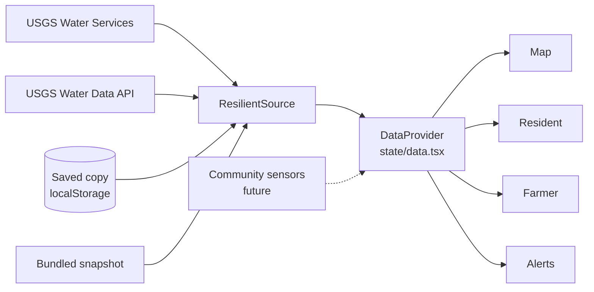

# How NiFi works

This guide is for the team, so each of you can explain any part of the app. Read it with the code open.

## One interface for every data source



Every provider implements the same interface (`src/data/types.ts`). The first two methods are required; the last two are optional:

```ts
interface DataSource {
  getSites(): Promise<Site[]>;                                        // where sensors are + latest reading
  getReadings(siteId: string, range: DateRange): Promise<Reading[]>;  // daily nitrate history
  getConditions?(siteId: string): Promise<Measurement[]>;             // river flow, temperature... right now
  getFlow?(siteId: string, range: DateRange): Promise<Reading[]>;     // daily river flow
}
```

The screens only ever see `Site`, `Reading`, and `Measurement`, so adding the team's community sensors later means writing one new class, and none of the screens change. A nitrate-only sensor can skip the two optional methods; the site page then leaves out the flow and conditions sections.

`ResilientSource` (`src/data/sources/resilient.ts`) is a DataSource that wraps the others. For each request it tries a recent saved copy first, then USGS Water Services, then the USGS Water Data API, then an older saved copy, and finally the bundled snapshot. It records which one answered in `status`, and the header shows that as "Live", "Saved data", or "Demo data". If every network request fails during a demo, the bundled data still shows.

## Where the data comes from

| What | Where | Notes |
|---|---|---|
| Latest readings | `waterservices.usgs.gov/nwis/iv/?stateCd=ia&parameterCd=99133` | iv = instantaneous values, every 15 minutes |
| Daily averages | `.../nwis/dv/?sites=…&parameterCd=99133&statCd=00003&period=P30D` | 00003 = daily mean; `P365D` for the 1-year view |
| Conditions now | `.../nwis/iv/?sites=…&parameterCd=00060,00065,00010,...` | flow, level, temperature, oxygen, turbidity, algae, pH, conductance |
| River flow | `.../nwis/dv/?sites=…&parameterCd=00060&statCd=00003` | cubic feet per second |
| Backup | `api.waterdata.usgs.gov/ogcapi/v0/collections/...` | USGS's newer service |
| Lab samples | `waterqualitydata.us/data/Result/search?statecode=US:19&siteType=Stream&characteristicName=Nitrate + Nitrite...` | Iowa DNR, Meskwaki Nation, Upper Mississippi program, Minnesota PCA |
| USGS lab samples | `api.waterdata.usgs.gov/samples-data/results/narrow?stateFips=US:19&usgsPCode=00631...` | parameter 00631 = nitrate + nitrite, filtered, as N |
| Rain | `api.open-meteo.com/v1/forecast` | 7 days back, 7 ahead |
| Map | OpenStreetMap tiles + bundled Census county outlines | |
| Town search | Census Gazetteer list of Iowa places, bundled | works offline |

Parameter 99133 is nitrate plus nitrite, in mg/L as nitrogen. USGS gives daily values without a time zone, so the app stores them at noon UTC and a date never slides to the day before (`parseDaily` in `usgsWaterServices.ts`). Sensors that only publish 15-minute readings get averaged by day (`dailyMeans`).

The other measurements need two checks, both in `latestMeasurements` (`src/lib/parameters.ts`). USGS writes -999999 when it has no value, and it still returns readings from sensors that stopped years ago. So the app drops any value below -999 and anything older than three days.

`scripts/build-demo-data.mjs` downloads all of this once and saves it in `src/data/bundled/` and `src/data/geo/`. That's the demo data. The year of history is stored as a start date plus one number per day, and `expandSeries` in `bundled.ts` turns it back into readings.

## Rivers without a live sensor

Only 12 Iowa streams have a working USGS nitrate sensor. USGS's site list shows others that stopped between 2011 and 2021. To cover more rivers, the data build also downloads lab samples: water someone collected by hand and had a lab test. About 90 sites qualify, most of them from Iowa DNR's monthly river monitoring.

The rules, all in `scripts/build-demo-data.mjs`:

- Only programs that give their stations real names are used (`LAB_AGENCIES`), so every site shows an actual river and agency.
- Only results reported "as N" in mg/L are kept, the same unit as the EPA limit. "Not detected" results have no value, so they're skipped.
- When a sample was reported as both "Total" and "Dissolved", the Total value is used. There's one value per site per day.
- A station within half a kilometer of a live sensor is dropped (the live sensor is newer). When two different programs sample the same spot, the one with the newest sample is kept. Half a kilometer is small on purpose: a creek can join a river a kilometer from another station, and that's a different stream.

In the app, these sites have `site.sampled` set (`src/data/types.ts`) and come from `LabSampleSource` (`src/data/sources/labSamples.ts`). They draw as hollow rings that shrink when you zoom out, their detail page says when and by whom the sample was taken, and the explanation is in the past tense (`explainSample` in `nitrate.ts`). Iowa DNR's newest public samples are from April 2025, so they're never used for alerts, "above the limit right now", the 3D view, the farm runoff check, or the main card on My Water.

## The math

- Level (`src/lib/nitrate.ts`): over 10 mg/L is red "Above limit" (EPA's limit), 5 to 10 is yellow "Elevated", and under 5 is green "Low". Exactly 10 counts as yellow because it isn't over the limit. The level goes by the number on screen, rounded to one decimal, so 4.97 (shown as "5.0") is yellow.
- Distance (`src/lib/geo.ts`): the haversine formula, which measures distance on a sphere: d = 2R·asin(√(sin²(Δlat/2) + cos(lat₁)·cos(lat₂)·sin²(Δlon/2))), with R = 3,958.8 miles.
- Trend (`src/lib/trend.ts`): a least-squares line through the daily readings (slope = Σ(x−x̄)(y−ȳ) / Σ(x−x̄)²), in mg/L per week. Over +0.3 is "rising", under −0.3 is "falling", and anything between is "steady".
- Nitrogen load (`src/lib/load.ts`): concentration × flow × 5.394 gives pounds of nitrogen per day. The 5.394 comes from 28.317 liters in a cubic foot × 86,400 seconds in a day ÷ 453,592 milligrams in a pound. At 14.5 mg/L and 1,290 ft³/s that's about 100,900 pounds, or 50 tons, a day. The acres comparison divides by 150 pounds an acre, a typical Iowa corn rate.
- A year of history (`src/lib/history.ts`): the highest and lowest days, how many days were over the limit, and what share of days were lower than today. Many sensors are pulled out of the river in winter, so it counts the days with readings and says so when there are gaps.
- Alerts (`src/lib/alerts.ts`): for sites within your alert distance, plus every watched site, the app compares today's level with the level about a week ago (`valueDaysBefore` in `trend.ts`). Moving up a level gives a "rose into…" alert, and anything over 10 gives an "above the limit" alert. A dismissed alert's id includes the date, so a problem on a new day shows again.
- Runoff risk (`src/lib/farmGuidance.ts`) adds up points. A nearby stream over 10 adds 2 (or 1 if it's 5 to 10). Rising streams add 1. An inch or more of rain forecast in the next 3 days adds 2 (half an inch adds 1). A wet past week adds 1, so does a high-loss season (spring, after harvest, or winter), and so does tile drainage. 0 to 2 points is low, 3 to 4 moderate, and 5 or more high. It's simple on purpose, so you can explain every point, and it's labeled as educational guidance.

## React in this app

- `main.tsx` starts React and registers the offline service worker.
- `App.tsx` wraps everything in three providers (React context), so any screen can call `useSettings()`, `useData()`, or `useNav()`.
- Screens in `src/pages/` load only when first opened (`React.lazy`), which makes the first screen appear faster.
- `state/settings.tsx` saves settings in `localStorage`, so they're remembered: mode, location, demo mode, and the watch list.
- `state/data.tsx` loads sites and asks each site's own source for its readings, flow, and conditions. Each request is made once and shared, so two screens showing the same river don't download it twice.
- `state/nav.tsx` keeps the tab in the URL (`#map`), so the back button and shared links work.

## The watch list

Tapping ☆ Watch (`components/WatchButton.tsx`) calls `toggleWatched` in `state/settings.tsx`. It adds the river's id and name to the top of `settings.watched`, or removes it if it's already there. Saving the name matters because a sensor pulled out for winter disappears from the site list, and without the name the app couldn't show which river it was.

The list shows up in four places. `WatchedRivers.tsx` is the card on the home screen, with each river's reading and change since last week. The map list has an "All / Watched" switch. Watched markers get a gold star (`MapView.tsx`). And `AlertBanners.tsx` adds watched sites to the ones it checks, wherever they are.

## The map

`src/components/MapView.tsx` uses Leaflet through react-leaflet. Each site is a `Marker` whose icon is HTML (`L.divIcon`) with the reading in a colored circle. Official sites are circles and community sites are dashed squares. Markers can be reached with Tab and announce themselves to screen readers. If map tiles fail to load, the bundled county outlines become the base map.

## The 3D views

The 3D code is in `src/three/` and uses three.js, which draws with the phone's graphics chip (WebGL).

- `useThreeScene.ts` does the setup every scene needs: the renderer, camera, drag-to-turn controls, a glow ("bloom") pass, and resizing. It also pauses when the scene is scrolled away or the tab is hidden, which saves battery, shows a still frame when motion is off, and frees graphics memory when you leave the screen. Each scene file only builds its objects and says how they move.
- `hologramMaterial.ts` is a small shader, a program that runs on the graphics chip for every pixel. It makes surfaces see-through and brighter at the edges ("fresnel"), with scan lines that crawl upward, a bright band that sweeps across, and a slight flicker. With additive blending, overlapping light adds up the way real light does.
- `HologramIowa.tsx` turns each county outline from the bundled Census map into a flat glass sheet. Each sensor is a pillar `reading × 0.12` tall, so the red EPA sheet sits at `10 × 0.12 = 1.2` (`projection.ts` also turns longitude and latitude into 3D positions). To find which pillar you tapped, a raycaster shoots an invisible line from your finger into the scene and checks which pillar it hits first. Each pillar has a wider, invisible "hit cylinder" so it's easy to tap.
- `NitrateMolecule.tsx` places three oxygen atoms 120° apart around a nitrogen atom, which is nitrate's real flat-triangle shape.
- `SensorHologram.tsx` is concept art. There's no sensor code in the app.
- `components/Safe3D.tsx` wraps every scene. It loads three.js only when a 3D view first opens, and if 3D fails on a device, only that box shows a note.

Stacking many see-through glowing layers turns everything white, so pillars and atoms draw only their front faces and the glow pass only picks up the brightest parts.

## The 3D website

The code that makes every screen 3D is in `src/fx/`. None of it uses three.js; it's CSS 3D and a little physics.

- `spring.ts` is a weight on a spring with friction (Hooke's law): force = −stiffness × (position − target) − damping × velocity. Each frame the force changes the velocity, and the velocity changes the position. The damping is set low enough that things overshoot and wobble a little before settling, which is why the boxes feel like objects.
- `useDepth.ts` gives a box its physics. With a mouse, it works out where the pointer is on the box and sets the springs' targets: tip toward that spot, lift 26 px toward you, press in 9 px when clicked. Every frame it writes the springs' values into CSS variables (`--rx`, `--ry`, `--tz`) on the element, and `index.css` turns those into a 3D transform and a shadow that slides and spreads. Writing straight to the element, instead of through React state, keeps a moving box from re-drawing the whole page 60 times a second. It also makes boxes rise into place when they scroll into view (an IntersectionObserver), and it listens for a `cc-nudge` event that kicks the springs (the Learn topic buttons use it) and a `cc-reveal` event that shows a box at once (`revealOnScreen`, for jumps that land somewhere new).
- The slab look in `index.css`: eight one-pixel shadows, each a darker green, draw the box's front edge, a thin bright line marks the top rim, and a soft shadow underneath moves with the tilt. Headings sit above the box (`translateZ`), so they shift against it as it tips. The glare is drawn under the text, so text never loses contrast.
- How a box rises in depends on the screen. The rise is one number, `--rv`, going from 1 to 0, multiplied by six per-screen variables (`--rv-x`, `--rv-y`, `--rv-z`, `--rv-rx`, `--rv-ry`, `--rv-rz`). Each screen's page sets `data-scene`, and a few CSS lines per screen set those variables: on Learn, odd boxes swing in from the left and even ones from the right, like pages.
- `pageTurn.ts` runs the transitions. The browser's View Transitions API takes a picture of the screen before and after a change, and `turnPage` puts a class like `cc-turn-dive` on `<html>` while it runs, which picks that transition's pair of animations in `index.css`. `TURNS` maps each tab to its transition (surface, dive, page, power, dial), and three more are used inside screens: `to-holo` and `to-flat` on the map's view switch, and `warp` for Learn's topic buttons. A transition can't start until the new screen has been drawn once, so `usePageTurnDone` makes 3D scenes and map markers wait until just after it. App.tsx also downloads every screen in the background so none of them has to load mid-transition.
- `SplitPanel.tsx` splits a river's details apart. The reading, the conditions, the nitrogen load, and each graph are separate panels, each with its place in the order (`--i`). They start stacked deep in the screen and fan out 110 ms apart. Each graph is keyed by its time span, so switching between 30 days and a year makes React draw a new graph, and its entrance animation flips it over.
- `World3D.tsx` is the background: a flat green grid tilted 82° so it runs to a glowing horizon, plus droplets placed at different depths. Moving the mouse moves the eye point (`perspective-origin`), and scrolling moves all the droplets the same distance in 3D, so the near ones slide past faster. That's parallax, the same cue your eyes use for depth.

Everything that moves depends on the `cc-fx` class on `<html>`, which `App.tsx` removes when motion is turned down in Settings or on the device. The depth (edges and shadows) stays either way.

## Offline and install (PWA)

`vite-plugin-pwa` generates a service worker (`dist/sw.js`) that saves the whole app, including the bundled data, on the first visit. Live USGS and weather responses are saved too: the app asks the network first and falls back to the saved copy when offline. OpenStreetMap tiles aren't saved for offline use, because OSM's policy forbids it. The manifest (in `vite.config.ts`) gives the app its name, colors, and icons so it can be added to a home screen.

## Tests

`npm test` runs 55 tests in five files:

- `src/fx/fx.test.ts` covers the spring physics (it overshoots a little, settles on its target, stays stable through a slow frame, and comes back to rest after a nudge) and that every tab gets its own transition, matched to where you're going.

- `src/data/sources/sources.test.ts` covers USGS parsing (streams only, stale sensors skipped, noon-UTC dates, 15-minute averaging, "no data" values), the fallback order, the bundled data including the year of history, and the lab samples (every site in Iowa with an agency and a real value, none repeating a live sensor's spot).
- `src/lib/lib.test.ts` covers levels at the exact boundaries, the plain-English explanations, distances, trends, alerts, runoff risk, guidance text, town search, and rain totals.
- `src/lib/parentSite.test.ts` covers the link back to The Street Health Project: NiFi shows it only when it's served from a `nifi/` folder on that site, and works out the site's address from its own.
- `src/lib/riverData.test.ts` covers conditions, the nitrogen-load math, the year summary, the watch list (including alerts for watched rivers far from home), and lab-sample sites: duplicates, no alerts, past-tense wording, and sample summaries.

## Questions judges might ask

**Why not Google Maps?** It needs an API key and a billing account. Leaflet with OpenStreetMap is free and keyless, and the app still works offline with bundled county maps.

**What if USGS is down?** The app tries a second USGS service, then a saved copy, then data bundled in the app, and the header says which one you're seeing.

**Is stream nitrate the same as my tap water?** No. Stream readings show what's moving through the watershed. City water must meet the 10 mg/L limit, and private wells should be tested every year.

**What does "tons of nitrogen a day" mean?** It's the nitrate reading multiplied by how much water is flowing. A small creek with high nitrate can carry less than a big river with lower nitrate. The total is what keeps flowing downstream and ends up in the Gulf.

**Isn't 3D just decoration?** The 3D map shows every sensor's reading as a height against the EPA limit at the same time, so you can see where the problem is concentrated. It's optional; the flat map and site list have the same data.

**Why are some readings from 2025?** Those are lab samples from rivers with no live sensor. Iowa DNR's newest samples in the public database are from April 2025. NiFi shows each sample's date and never treats it as current. That gap is also the case for a cheap sensor: most Iowa rivers have no up-to-date nitrate data at all.

**How would your sensor connect?** As a new `DataSource` with `kind: 'community'`. The map and charts already draw community data differently.
